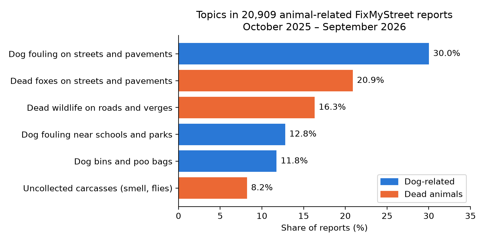

# Topic analysis of animal-related FixMyStreet reports

Portfolio project for DLBDSEDA02 Project: Data Analysis (IU), Task 1: identifying the most frequent topics in citizen complaints with NLP.

## Data source

- **Source:** FixMyStreet (UK), public Open311 API (https://www.fixmystreet.com/open311), operated by mySociety.
- **Scope:** 73 animal-related categories (dog fouling, dead animals, dog bins, pests, and other animal issues), selected by a keyword search over all 2,601 category names. The list is saved in `animal_categories.csv`.
- **Period:** October 1, 2025 – September 30, 2026 (UK local time), collected on November 21, 2026.
- **Size:** 20,929 reports from 57 categories, sent to 257 council recipients (including combinations of two councils).
- **Fields used:** title, detail, category, date, council, and reporting channel. Reporter names, coordinates, and photos were dropped.

### Why the raw data are not in this repository

The report texts were written by citizens and can contain personal details such as addresses. The raw data are therefore not published here; the `data/` folder is excluded via `.gitignore`. The analysis notebook shows a few short excerpts (standardized duplicate texts, test reports, and three example reports per topic) to explain the cleaning steps and the topic names. The same texts are publicly visible on FixMyStreet.

### How to re-collect the data

Run `notebooks/01_data_collection.ipynb` from top to bottom. It downloads the reports per category and month (about 900 requests, 15–20 minutes) and saves one JSON file per month in `data/`.

mySociety describes the API as work in progress, and councils change their categories over time. A later download may therefore differ slightly from the 20,929 reports used here.

## Setup

Tested with Python 3.14 on macOS.

1. Clone the repository and open a terminal in its folder:

   ```bash
   git clone https://github.com/nosadfountains/DLBDSEDA02-fixmystreet-topic-analysis.git
   cd DLBDSEDA02-fixmystreet-topic-analysis
   ```

2. Create and activate a virtual environment, then install the packages:

   ```bash
   python3 -m venv .venv
   source .venv/bin/activate
   pip install -r requirements.txt
   ```

   On Windows, activate the environment with `.venv\Scripts\activate`.

3. Open the notebooks in VS Code (with the Jupyter extension) and select the `.venv` kernel.

The analysis notebook downloads three NLTK resources (`punkt_tab`, `stopwords`, `wordnet`) on its first run. With Python from python.org on macOS, this can fail with `CERTIFICATE_VERIFY_FAILED`. In that case, run `Install Certificates.command` once (in the Python folder under Applications) and run the cell again.

## How to run

1. `notebooks/01_data_collection.ipynb` downloads the data into `data/` (see "How to re-collect the data" above). Skip it if `data/` already contains the 12 monthly files.
2. `notebooks/02_analysis.ipynb` runs the analysis. Restart the kernel and run all cells from top to bottom; the notebook takes about 20–30 minutes, most of it for the silhouette comparison. It saves the figure and three CSV files to `results/`.

## Results

The final model (LDA with Bag of Words, 6 topics) was trained on 15,963 reports and applied to all 20,909 reports (20 test submissions excluded).

| Topic | Reports | Share |
| --- | ---: | ---: |
| Dog fouling on streets and pavements | 6,278 | 30.0% |
| Dead foxes on streets and pavements | 4,369 | 20.9% |
| Dead wildlife on roads and verges | 3,410 | 16.3% |
| Dog fouling near schools and parks | 2,673 | 12.8% |
| Dog bins and poo bags | 2,457 | 11.8% |
| Uncollected carcasses (smell, flies) | 1,715 | 8.2% |



Dog-related topics make up 54.6% of the reports, dead-animal topics 45.4%. In 95.6% of the reports, the topic matches the group of the category chosen by the reporter (dog or dead animal). The topics add what the categories do not show: where a problem occurs and what kind of problem it is.

## Method and comparison

- **Preprocessing:** title and detail combined; lowercase, NLTK tokenization, letters only, NLTK English stop words plus 17 domain words, WordNet lemmatizer.
- **Training set:** reports without their own description (3,510), with fewer than 8 words, exact repeats, and test submissions were excluded from training but kept for counting.
- **Vectorizers:** Bag of Words and TF-IDF, single words and word pairs, terms in at least 10 reports (3,954 terms). Both use the same vocabulary; TF-IDF down-weights words that appear in most reports. TF-IDF was robust to 13 test submissions, which created a whole LSA topic with Bag of Words.
- **Topic models:** LSA and LDA were each applied to both matrices (k = 4 to 12). LSA dimensions overlapped with both vectorizers. LDA with Bag of Words gave the clearest topics, although LDA with TF-IDF reached a higher silhouette score (0.683 vs. 0.611 at k = 6). I chose k = 6 by top words, example texts, and silhouette scores; with k = 8, dog fouling split into three overlapping topics. A variant without the words "dog" and "dead" mixed dead animals and dog fouling and was rejected.

## Data quality

- 2,521 of 2,526 reports sent through council systems (Open311) contain no description of their own, only the category name. Together with other reports of this kind (3,504 in total), they were assigned to topics by these words alone; 2,469 of them are in "Dog fouling on streets and pavements". Without these reports, this topic would still be the largest (21.9%).
- 20 test submissions were found in the live data and excluded.
- The texts are short (median 18 words), which limits LDA.
- Councils use different category names for the same issue (57 categories with reports).
- FixMyStreet reports are not representative of all residents or areas.

## Repository structure

- `notebooks/01_data_collection.ipynb`: data collection via the Open311 API
- `notebooks/02_analysis.ipynb`: preprocessing, vectorization, topic models, and results
- `results/`: figure (`topic_shares.png`) and tables (`topic_shares.csv`, `topics_vs_categories.csv`, `topic_top_words.csv`)
- `animal_categories.csv`: the 73 selected categories
- `requirements.txt`: package versions
- `data/`: raw data (local only, not in the repository)